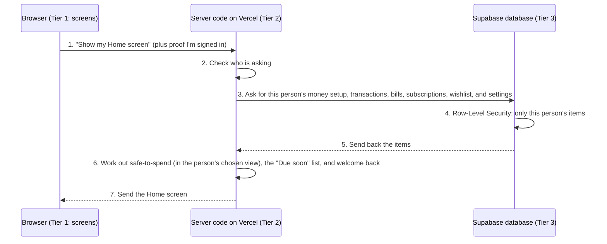

# Architecture – MVP 1

This page explains how the app is put together, in plain words. It's built from
docs/specs and these decisions:
- ADR-0001: Next.js + Material UI (Accepted)
- ADR-0002: manual entry with fake sample data, no bank connection (Accepted)
- ADR-0003: host on Vercel (Accepted)
- ADR-0004: store data in Supabase (Accepted)
- ADR-0005: in-app reminders for the first build (Accepted)
- ADR-0006: no email confirmation or SMS in the class build (Proposed)

The details of every saved table and column are in docs/database-design.md.

Answers to earlier open questions are marked with the day they were decided, like
*(Decided Nov 24, 2026)*.

The app has three layers, or "tiers." Think of a restaurant:
- **Tier 1, screens:** the dining room. It's what people see and touch.
- **Tier 2, server code on Vercel:** the kitchen. It's where the work and the
  rules happen.
- **Tier 3, database on Supabase:** the pantry. It's where information is kept.

Guests never walk into the pantry. The browser never talks to the database
directly. It asks the server, and the server talks to the database (rule 5 in
CLAUDE.md).

---

## Tier 1: Screens (built with Material UI)

| Screen | What people do there | From spec |
|---|---|---|
| Sign up | Create an account with an email and password. There's no confirmation email, so the person is signed in right away. The browser's time zone is saved. *(Decided Nov 24, 2026)* | 6.1, ADR-0006 |
| Sign in | Sign in, or tap "Forgot password?" After signing in: if the last visit was under 7 days ago, go to Home. If it was 7 days or more, go to Welcome back. *(Decided Nov 24, 2026)* | 6.1, 5.1 |
| Forgot password | Four screens, one action each, with kind wording, using Supabase's emailed reset link: (1) enter your email; (2) "Check your email. The link works for 1 hour."; (3) set a new password, with a show/hide button; (4) "All set! You're signed in." → Home. *(Decided Nov 24, 2026)* | 6.1, T9, ADR-0006 |
| Privacy screen | Read, in plain words, what we save and why, plus a "not financial advice" note. Shown **only once**, right after sign-up, and the app saves that it was seen. Can be opened anytime under More → Your data. *(Decided Nov 18, 2026; "only once" decided Nov 24, 2026)* | 6.2, T13 |
| Home | See one safe-to-spend number, with a toggle between **"Per day"** (the default) and **"Until payday."** Tap the "Pause check" button. See the "Due soon" list (see below). While sample data is in use, see a note: "This is sample data. Start with your own?" with a "Clear sample data and start fresh" button. *(Decided Nov 18, 2026; toggle decided Nov 24, 2026)* | 1.2, 2.2, 3.1, ADR-0002, ADR-0005 |
| Set up your money | Two short screens, one question each, shown right after "Clear sample data and start fresh": "How much is in your account today?" and "When is your next payday, and how often does it come?" Each has a "Skip for now" button; if skipped, Home shows "not sure yet" instead of a number. *(Decided Nov 22, 2026)* | 1.2, T7, T9 |
| How it's worked out | Plain-words explanation of both views. "Until payday" = money available − upcoming bills before next payday − savings set aside. "Per day" = that amount ÷ days left until payday. Change the "savings set aside" amount here. Includes the "not financial advice" note. *(Decided Nov 18, 2026; two views decided Nov 24, 2026)* | 1.2, T13 |
| Transactions | See entries sorted into categories, and fix a category | 1.1 |
| Add or edit a transaction | Type in a transaction by hand, edit it, or delete it. The app suggests a category, and the person can change it in one tap. *(Decided Nov 18, 2026)* | 1.1, ADR-0002 |
| Bills | See found bills; confirm, edit, or dismiss them; add a bill by hand, and delete one you added by hand; mark a bill "paid" or "remind me later" in one tap. *(Delete rule decided Nov 24, 2026)* | 2.1, 2.2 |
| Upcoming bills calendar | See which bills are coming up before payday | 2.2 |
| Pause check | Opened from the button on Home. Type a price, see the new safe-to-spend number **in whichever view is on** (per day or until payday), and get a heads-up if it's near the limit. *(Decided Nov 24, 2026)* | 3.1 |
| Wishlist | Park a want with a waiting period of 1 day, 3 days, or 1 week (1 day is picked by default). Remove it or buy it later. *(Decided Nov 18, 2026)* | 3.2 |
| Subscriptions | See every subscription and the monthly total; dismiss one that was wrongly found, or delete one you added by hand. *(Delete rule decided Nov 24, 2026)* | 4.1 |
| Subscription details | See the next charge, an optional trial end date, and a "How to cancel" note the person can fill in. *(Decided Nov 18, 2026)* | 4.2 |
| Welcome back | Shown after a gap (7 days or more since the last visit) or a slip (safe-to-spend below zero). Says "Welcome back! Let's take a quick look at your plan," then asks one question: "How much is in your account today?" → Home. Old entries, bills, and subscriptions stay as they are. *(Decided Nov 18 and 22, 2026; wording and flow decided Nov 24, 2026)* | 5.1 |
| Notification settings | Choose which types, how often, and quiet hours. These control what shows in the "Due soon" list, and when (see below). *(Decided Nov 18, 2026)* | 5.2, ADR-0005 |
| Your data | Export all your data, or delete your account and all your data. Open the privacy screen. | 6.2 |
| Sign out | A "Sign out" button under More. *(Decided Nov 24, 2026)* | 6.1 |

**The "Due soon" list on Home** *(Decided Nov 18, 2026)*
There are no emails or push notifications in this build (ADR-0005). Reminders and
warnings appear in a "Due soon" list on Home instead:
- bills due today or in the next 3 days
- free trials ending, or yearly renewals charging, in the next 3 days
- wishlist items whose waiting period is over

How notification settings change the list *(Decided Nov 22, 2026)*:
- **Types:** turn each kind on or off: bills, trials and renewals, wishlist.
- **How often:** "Every time I open the app," or "Once a day." With "Once a day,"
  after the first look the list shrinks to one line until tomorrow.
- **Quiet hours:** during those hours, the list shrinks to one calm line, like
  "3 things are due soon. Tap to see." It never disappears, so a bill due today
  is never fully hidden.

**Getting around** *(Decided Nov 18, 2026)*
A Material UI bottom menu with five items: Home, Transactions, Bills,
Subscriptions, and More. "More" holds the wishlist, notification settings,
"Your data," and "Sign out." *(Sign out added Nov 24, 2026)*

**First visit** *(Decided Nov 18, 2026; updated Nov 24, 2026)*
Sign up (signed in right away) → privacy screen (shown only this once) → Home,
which shows the sample data's safe-to-spend number with the "This is sample data"
note.

**Coming back** *(Decided Nov 24, 2026)*
Sign in → if the last visit was under 7 days ago: Home. If it was 7 days or more:
Welcome back → one-step balance reset → Home.

**Rules every screen follows (from the specs)**
- One decision per screen (T9).
- No red numbers, no "you overspent," and kind, non-judging words, even when the
  number is low or zero (5.1, 1.2).
- Text at about a 7th-grade reading level (T9).
- Meets WCAG 2.2 AA and W3C COGA (T9).
- Reduced motion follows the person's device setting, with no separate in-app
  switch (T9). *(Decided Nov 18, 2026)*
- Works on current Chrome, Safari, Firefox, and Edge, and on small phones with
  no sideways scrolling (T11).
- Screens never talk to the database. They only ask the server (rule 5).

---

## Tier 2: Server code on Vercel (where the rules live)

| Business rule | What it does | From spec |
|---|---|---|
| Who's asking? | Checks that the person is signed in on every request, and only lets them reach their own data | T2, T3 |
| Sign-in and sign-out | Supabase Auth with email and password. No confirmation email (ADR-0006). "Forgot password" sends Supabase's reset link, which works for 1 hour. "Sign out" ends the session. **Passwords must be at least 8 characters.** We keep Supabase's built-in limits on repeated sign-in, sign-up, and reset attempts, and Supabase's default session settings (how long someone stays signed in, and how sessions refresh). *(Decided Nov 24, 2026)* | 6.1, T3, T5 |
| Check what's typed in | Makes sure amounts, dates, and names make sense before saving, and cleans the text | T5 |
| Dates and time zone | "Today," due dates, and payday all use the time zone saved from the person's browser at sign-up. *(Decided Nov 24, 2026)* | T7 |
| Sort into categories | Suggests a category from the transaction's name using simple rules, and remembers when a person fixes one. *(Decided Nov 18, 2026)* | 1.1, T12 |
| Find repeat bills | Looks through entered transactions for payments that repeat, and finds their name, amount, and due date | 2.1, T12 |
| Find subscriptions | Looks through entered transactions for subscriptions, finds the amount and how often they charge, and adds up the monthly total | 4.1, T12 |
| Dismissed bills and subscriptions | **Found bills and subscriptions are dismissed; ones you added by hand can be deleted.** When a person says a found bill or subscription is wrong, it's marked "dismissed" instead of deleted, so the app doesn't find it again. Each bill and subscription is marked as added by hand or found, so the app knows which choice to offer. *(Decided Nov 24, 2026)* | 2.1, 4.1 |
| Safe-to-spend math | **One calculation, two views.** *(Decided Nov 24, 2026)* **Until payday** = money available − upcoming bills before next payday − savings set aside. **Per day** = the until-payday amount ÷ days left until payday. Days left counts from today, so if payday is tomorrow, there's 1 day left. If payday is today or tomorrow, both views show the same number. **Per day is the default**, and each person's choice is saved in their settings. The toggle only changes what's shown, not the math. **Bills and subscriptions are never subtracted twice.** **Money available** = the "money in my account today" number the person typed, raised or lowered by each transaction they add after that. **Savings set aside** = one amount per pay period, starting at $0. If the balance or payday is missing, it shows "not sure yet" instead of guessing. It records how each number was worked out. *(Decided Nov 18, 2026)* | 1.2, T7 |
| Pause check math | Shows the effect of a planned purchase in whichever view is on. It's "near the limit" when less than 20% of today's safe-to-spend would be left, or the purchase would go past it. *(Decided Nov 18, 2026)* The 20% rule works the same in both views. *(Decided Nov 24, 2026)* | 3.1 |
| "Due soon" list | Builds the list on Home: bills due today or in the next 3 days, trials and yearly renewals in the next 3 days, and wishlist items whose waiting period is over. Follows each person's notification settings. "Paid" removes a bill. "Remind me later" hides it until tomorrow. *(Decided Nov 18, 2026)* Shows only the types that are turned on. Shrinks the list to one line during quiet hours, and after the first look of the day when "Once a day" is chosen. *(Decided Nov 22, 2026)* | 2.2, 3.2, 4.2, 5.2, ADR-0005 |
| Welcome back | Shows Welcome back when the last visit was 7 days ago or more, or when safe-to-spend is below zero. The below-zero rule works the same in both views. *(Decided Nov 18 and 24, 2026)* The reset saves the new "money in my account today" number and its date, keeps everything else, and works out safe-to-spend again. *(Decided Nov 22, 2026)* | 5.1 |
| Privacy screen, once | Shows the privacy screen right after sign-up, then saves that it was seen so it doesn't show again. *(Decided Nov 24, 2026)* | 6.2 |
| Worked out when the app opens | There's no daily scheduled job. Bills, subscriptions, safe-to-spend, the "Due soon" list, and welcome back are all worked out when the person opens the app. *(Decided Nov 18, 2026)* | Changes 06 step 9 |
| Sample data | Every new person starts with clearly labeled sample data. Every sample row has an "is sample" marker, and "Clear sample data" deletes **only** rows with that marker. *(Decided Nov 18, 2026; marker rule decided Nov 24, 2026)* After clearing, the person goes to the "Set up your money" screens. *(Decided Nov 22, 2026)* | ADR-0002 |
| Export and delete | Gives a person all their data, or deletes their account and all their data right away and completely. *(Decided Nov 18, 2026)* Deleting the account uses Supabase's admin delete with the service-role key, **only in server code**. The database then removes all their rows automatically. (ADR-0004) | 6.2, T6 |
| Privacy-safe counting | Uses Vercel Web Analytics, which counts page visits without cookies or personal details. *(Decided Nov 18, 2026)* | T14 |

**How the server keeps things safe**
- People sign in with an email and password only, through Supabase Auth.
  *(Decided Nov 18, 2026)* (T3, ADR-0004)
- Email confirmation is off for this class build (ADR-0006). It must be turned
  back on, with a real email sender, before any real launch.
- Passwords are at least 8 characters. Supabase's built-in attempt limits slow
  down anyone guessing passwords, and its default session settings handle how
  long people stay signed in (T3, T5). *(Decided Nov 24, 2026)*
- Secret keys live only in Vercel's settings and in `.env.local` on your
  computer. They never go in the code or on GitHub (rule 4, T1, ADR-0003).
- The powerful Supabase "service-role" key (a master key that skips the safety
  checks) is used only in server code, only for actions that truly need it, like
  deleting an account (T2, ADR-0004).
- HTTPS only, plus security settings on every page (T5).
- The rules for categories, bills, and subscriptions are settings with
  automatic tests, not fixed in the code (T12).

---

## Tier 3: Database on Supabase (what we save)

Every saved item belongs to one person. The database also checks this itself,
using a feature called **Row-Level Security**, so each person can only read and
change their own items (T2, ADR-0004). We save only what we need (T6).

**Money is saved in US cents, as whole numbers.** For example, $12.50 is saved
as 1250. US dollars only. *(Decided Nov 24, 2026)*

- **People:** an email address and sign-in details. Supabase handles passwords,
  and they're never saved as plain text (6.1, T3).
- **Money setup:** "money in my account today" and the date it was typed; the
  next payday and how often it repeats; and savings set aside per pay period.
  Each person has one money total, with no separate accounts like checking or
  credit card. *(Decided Nov 18, 2026)*
- **Transactions:** the date, the amount, what it was for, its category, and
  whether money came in or went out.
- **Category memory:** "when it says *this*, use *that* category," saved when a
  person fixes a category (1.1).
- **Bills:** the name, amount, due date, how often it repeats, whether the person
  confirmed it, whether it's paid this time, the date "remind me later" hides it
  until, and whether it was dismissed (2.1, 2.2).
- **Subscriptions:** the name, amount, how often it charges, the next charge
  date, an optional trial end date, the "How to cancel" note, and whether it was
  dismissed (4.1, 4.2). *(Decided Nov 18, 2026)*
- **Wishlist items:** the name, price, waiting period (1 day, 3 days, or 1 week),
  date added, and whether the person has decided (3.2).
- **Settings:** which types show in "Due soon," how often, and quiet hours
  (5.2); the date the person last opened the app, so welcome back knows about a
  7-day gap (5.1), and so "Once a day" knows whether they've already looked
  today *(Decided Nov 22, 2026)*; plus their **time zone**, their **safe-to-spend
  view** (per day or until payday), and **when they saw the privacy screen**
  *(Decided Nov 24, 2026)*.
- **Sample data mark:** every sample row has an "is sample" marker, so one button
  can remove all of it and nothing else (ADR-0002). *(Decided Nov 24, 2026)*

**How saved data is protected** *(Decided Nov 18, 2026)*
- Supabase encrypts all stored data on its disks, and all data travels over
  HTTPS (T6). We add nothing extra for now, because all the data is fake. If the
  app ever holds real data, amounts and transaction names should get extra
  protection.
- When someone deletes their account, their data is deleted right away and
  completely. Nothing is kept, because all the data is fake.

---

## How one request travels

Example: a person opens the Home screen.

The same steps in words:
1. The browser asks the server for the Home screen. It includes a small saved
   note (a "cookie") that proves the person is signed in.
2. The server checks who is asking. If they're not signed in, it sends them to
   the Sign in screen.
3. The server asks the database for that person's money setup, transactions,
   bills, subscriptions, wishlist, and settings.
4. The database checks that every item belongs to that person.
5. The database sends the items back to the server.
6. The server works out the safe-to-spend number in the person's chosen view
   (using their time zone for "today"), builds the "Due soon" list, and checks
   whether to show welcome back. This happens every time the app opens, because
   there's no daily job.
7. The server sends back the Home screen, and the browser shows it.

The browser never talks to the database, and secret keys never leave the server.

---

## Open questions

These were found when checking the docs on Nov 24, 2026. Each has a suggested
answer, but **none of them is decided yet.**

1. **How exactly are repeat bills and subscriptions found?** T12 asks for written
   rules with automatic tests, and these aren't written yet.
   *Suggested:* A repeat payment is the same name appearing at least 2 times,
   about the same time apart (weekly, every 2 weeks, monthly, or yearly, give or
   take 3 days), with amounts within 10% of each other. If its category is
   "Subscriptions," it's a subscription; otherwise it's a bill. The rules live
   in a settings file, with tests that use the sample data.
2. **What format is the data export?**
   *Suggested:* One JSON file (a plain-text data file) with everything in it.
   It's the simplest to build and nothing gets left out. A spreadsheet-friendly
   CSV version can come later.
3. **Which web addresses can Supabase's sign-in and reset links send people
   back to?** These are called "redirect URLs," and they aren't set yet.
   *Suggested:* Set Supabase's main address ("Site URL") to the live Vercel
   address. Allow `http://localhost:3000/**`, the live Vercel address `/**`,
   and a wildcard pattern for Vercel preview addresses. This needs the live
   Vercel address.
4. **Where exactly is the "Per day / Until payday" toggle?** The decision says
   "on the safe-to-spend screen."
   *Suggested:* On Home, right under the number, because that's where the number
   is. (This document already shows it there.)
5. **Does "upcoming bills" also include subscription charges due before payday?**
   *Suggested:* Yes. Both are money that will leave before payday. Each charge is
   counted once, even if it shows up in both lists.
6. **How does the app avoid subtracting a bill twice when the person also types
   in the payment as a transaction?**
   *Suggested:* Tapping "Paid" takes the bill out of "upcoming." When someone adds
   a transaction whose name matches an upcoming bill, the app asks one question:
   "Is this your Rent bill?" Yes marks it paid.
7. **How is the per-day number rounded?**
   *Suggested:* Round down to the whole cent, so it never shows more than is
   safe.

---

## Step 8 setup list (Supabase dashboard)

*(Started Nov 24, 2026.)* Settings to change by hand in the Supabase dashboard
(Supabase's settings website). Only decided items are listed here.

- [ ] Turn off "Confirm email" for email sign-ups (ADR-0006).
- [ ] Set the minimum password length to 8 characters. *(Decided Nov 24, 2026)*
- [ ] Leave the built-in limits on sign-in, sign-up, and reset attempts as they
      are. *(Decided Nov 24, 2026)*
- [ ] Leave the default session settings as they are. *(Decided Nov 24, 2026)*
- [ ] Set the redirect URLs, after open question 3 is answered.

---

## Later ideas (not MVP 1 requirements)

*(Added Nov 24, 2026.)* These are ideas for later versions. MVP 1 doesn't need
them.

- **FAQ in the menu:** a short help page with common questions.
- **Email reminders:** reminders that reach people when the app is closed
  (ADR-0005).
- **Custom email sender:** our own email service, so reset emails reach anyone,
  not just our Supabase team (ADR-0006).
- **SMS confirmation:** confirming accounts by text message, which needs a paid
  service and real phone numbers (ADR-0006).
