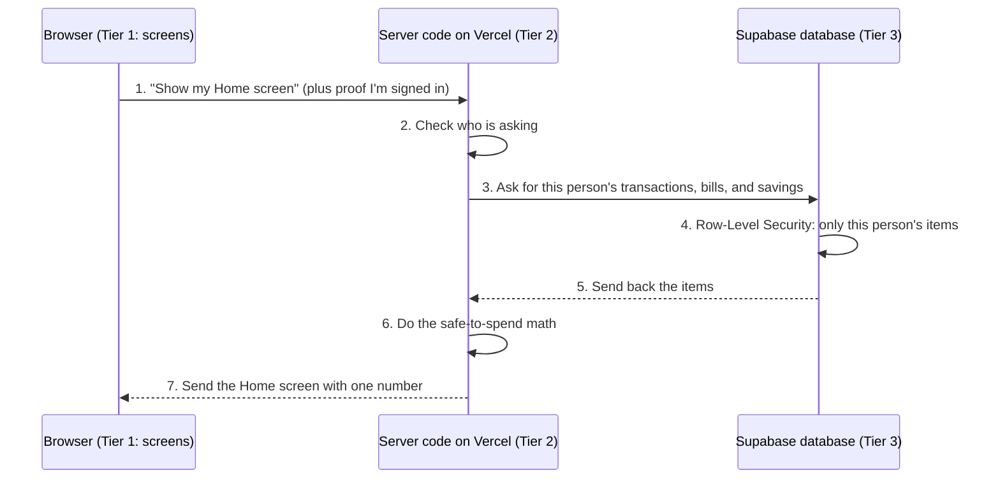

# Architecture – MVP 1

This page explains how the app is put together, in plain words. It's built from
docs/specs and two decisions: ADR-0001 (Next.js + Material UI) and ADR-0002
(manual entry with fake sample data, no bank connection).

The app has three layers, or "tiers." Think of a restaurant:
- **Tier 1, screens:** the dining room. It's what people see and touch.
- **Tier 2, server code on Vercel:** the kitchen. It's where the work and the
  rules happen.
- **Tier 3, database on Supabase:** the pantry. It's where information is kept.

Guests never walk into the pantry. The browser never talks to the database
directly. It asks the server, and the server talks to the database (rule 5 in
CLAUDE.md).

---

## Tier 1: Screens (built with Material UI)

| Screen | What people do there | From spec |
|---|---|---|
| Sign up | Create an account | 6.1 |
| Sign in | Sign in, or go to "forgot password" | 6.1 |
| Reset password | Set a new password | 6.1 |
| Privacy screen | Read, in plain words, what we save and why | 6.2 |
| Home | See one number: what's safe to spend today | 1.2 |
| How it's worked out | Plain-words explanation: money available − upcoming bills − savings set aside, until next payday | 1.2 |
| Transactions | See entries sorted into categories, and fix a category | 1.1 |
| Add or edit a transaction | Type in a transaction by hand, edit it, or delete it | 1.1, changed by ADR-0002 |
| Bills | See found bills; confirm, edit, or delete them; add a bill by hand; mark a bill "paid" or "remind me later" in one tap | 2.1, 2.2 |
| Upcoming bills calendar | See which bills are coming up before payday | 2.2 |
| Pause check | Type a price, see the new safe-to-spend number, and get a heads-up if it's near the limit | 3.1 |
| Wishlist | Park a want with a waiting period; remove it or buy it later | 3.2 |
| Subscriptions | See every subscription and the monthly total; remove one that was wrongly flagged | 4.1 |
| Subscription details | See the next charge, trial or renewal warnings, and simple cancel steps | 4.2 |
| Welcome back | Reset in one step after a gap or a slip | 5.1 |
| Notification settings | Choose which notifications, how often, and quiet hours | 5.2 |
| Your data | Export all your data, or delete all of it | 6.2 |

**Reminders and warnings are not screens.** They arrive as notifications
(T8). See the open questions.

**Rules every screen follows (from the specs)**
- One decision per screen (T9).
- No red numbers, no "you overspent," and kind, non-judging words, even when the
  number is low or zero (5.1, 1.2).
- Text at about a 7th-grade reading level (T9).
- Meets WCAG 2.2 AA and W3C COGA, and offers reduced motion (T9).
- Works on current Chrome, Safari, Firefox, and Edge, and on small phones with
  no sideways scrolling (T11).
- Screens never talk to the database. They only ask the server (rule 5).

---

## Tier 2: Server code on Vercel (where the rules live)

| Business rule | What it does | From spec |
|---|---|---|
| Who's asking? | Checks that the person is signed in on every request, and only lets them reach their own data | T2, T3 |
| Check what's typed in | Makes sure amounts, dates, and names make sense before saving, and cleans the text | T5 |
| Sort into categories | Puts each transaction in a category, and remembers when a person fixes one | 1.1, T12 |
| Find repeat bills | Looks through entered transactions for payments that repeat, and finds their name, amount, and due date | 2.1, T12 |
| Find subscriptions | Looks through entered transactions for subscriptions, finds the amount and how often they charge, and adds up the monthly total | 4.1, T12 |
| Safe-to-spend math | Money available − upcoming bills − savings set aside, until next payday. Says "not sure yet" instead of a wrong number when information is missing, and records how each number was worked out | 1.2, T7 |
| Pause check math | Works out the safe-to-spend number after a planned purchase, and decides if it's near the limit | 3.1 |
| Wishlist timer | Holds an item for its waiting period, then reminds the person to decide | 3.2 |
| Bill reminders | Reminds a few days before and on the due day; handles "paid" and "remind me later" | 2.2 |
| Trial and renewal warnings | Warns before a free trial turns paid and before a yearly renewal | 4.2 |
| Sending notifications | Follows each person's settings and quiet hours; never shows money details in the preview | T8, 5.2 |
| Welcome back | Notices a gap or a slip and offers the one-step reset | 5.1 |
| Export and delete | Gives a person all their data, or deletes all of it | 6.2, T6 |
| Sample data | Gives the app its fake sample data | ADR-0002 |
| Daily refresh | Once a day, recalculates bills, subscriptions, and safe-to-spend, and checks which reminders and warnings are due | 06 step 9, changed by ADR-0002 |
| Privacy-safe counting | Counts only anonymous totals; never saves transaction text or amounts tied to a person | T14 |

**How the server keeps things safe**
- Secret keys live only in Vercel's settings and in `.env.local` on your
  computer. They never go in the code or on GitHub (rule 4, T1).
- The powerful Supabase "service-role" key (a master key that skips the safety
  checks) is used only on the server (T2).
- HTTPS only, plus security settings on every page (T5).
- The rules for categories, bills, and subscriptions are settings with
  automatic tests, not fixed in the code (T12).

---

## Tier 3: Database on Supabase (what we save)

Every saved item belongs to one person. The database also checks this itself,
using a feature called **Row-Level Security**, so each person can only read and
change their own items (T2). We save only what we need (T6).

- **People:** an email address and sign-in details. Supabase handles passwords,
  and they're never saved as plain text (6.1, T3).
- **Transactions:** the date, the amount, what it was for, its category, whether
  money came in or went out, and whether it's sample data.
- **Category memory:** "when it says *this*, use *that* category," saved when a
  person fixes a category (1.1).
- **Bills:** the name, amount, due date, how often it repeats, whether the person
  confirmed it, and whether it's paid or snoozed this time (2.1, 2.2).
- **Subscriptions:** the name, amount, how often it charges, the next charge
  date, the trial end or yearly renewal date, and cancel steps (4.1, 4.2).
- **Wishlist items:** the name, price, waiting period, date added, and whether
  the person has decided (3.2).
- **Settings:** which notifications are on, how often, and quiet hours (5.2).

---

## How one request travels

Example: a person opens the Home screen to see their safe-to-spend number.

The same steps in words:
1. The browser asks the server for the Home screen. It includes a small saved
   note (a "cookie") that proves the person is signed in.
2. The server checks who is asking. If they're not signed in, it sends them to
   the Sign in screen.
3. The server asks the database for that person's transactions, bills, and
   savings.
4. The database checks that every item belongs to that person.
5. The database sends the items back to the server.
6. The server does the safe-to-spend math.
7. The server sends back the Home screen with one number, and the browser shows
   it.

The browser never talks to the database, and secret keys never leave the server.

---

## Open questions

These aren't in the specs yet, so they're not decided here.

**The safe-to-spend number**
1. With no bank, where does "money available" come from? Does the person type in
   a starting balance?
2. How does the app know when payday is?
3. How does a person set "savings set aside"?
4. What is "the limit," and what counts as "near" it?
5. The specs list an "accounts" table (06, Phase 0). Do we still need accounts
   (like checking vs. credit card) without a bank connection?

**Entering money**
6. When someone types a transaction, does the app suggest a category, or does
   the person always pick one?
7. Sample data: does every new person start with it, or is it a separate demo?
   Can people clear it in one step? Does it mix with their own entries?
8. How does the app learn when a free trial ends? Does the person type it in?
9. Who writes the cancel steps? One shared list for everyone, or typed by each
   person?

**Reminders and notifications**
10. How many days before a bill is "a few days"? How long is "remind me later"?
11. How far ahead do we warn about a trial or renewal?
12. Do notifications arrive by push, by email, or both (T8 says "push/email")?
13. What counts as a "gap" or a "slip" for the welcome-back screen?
14. Which waiting periods can people choose for the wishlist?

**Screens and flow**
15. Where does the privacy screen go now that there's no bank step?
16. What happens between sign-up and the first safe-to-spend number?
17. Where do people see the "not financial advice" note (T13)?
18. How do people move between screens (what kind of menu)?
19. Is reduced motion an in-app setting, or does the app follow the device's
    setting (T9)?

**Technical**
20. How does the daily refresh run on Vercel (it needs a scheduled job)?
21. Which saved details count as "sensitive" and get extra encryption (T6)?
22. Where do the anonymous counts go (T14)?
23. Sign-in: email and password only, or also a "magic link" (a sign-in link sent
    by email) (T3 says optional)?
24. How long is data kept after someone deletes it ("subject to legal retention"
    in 05)?
