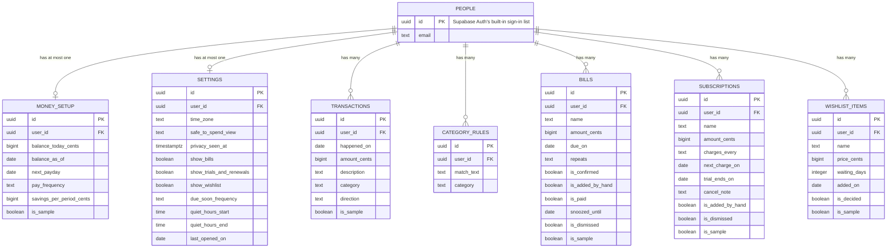

# Database Diagram – MVP 1

How the tables connect. Details for every column are in docs/database-design.md.

Money is saved in US cents as whole numbers (`bigint`): $12.50 is 1250.
Money columns end in `_cents`.

## The same thing in words

- **PEOPLE** is Supabase's built-in sign-in list. We don't create it.
- Each person has **at most one** money setup and **at most one** settings row.
- Each person can have **many** transactions, category rules, bills,
  subscriptions, and wishlist items.
- Every one of those rows belongs to **exactly one** person, through `user_id`.
- The other tables don't point to each other. They only point to the person.

**Symbols used:**
- **PK** ("primary key") is the row's own unique ID.
- **FK** ("foreign key") is a pointer to the row it belongs to.
- In the lines, `||` means "exactly one," `o|` means "zero or one," and `o{`
  means "zero or many."
